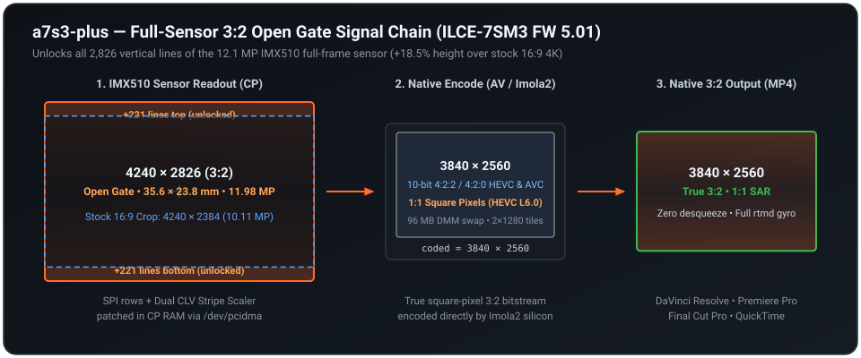
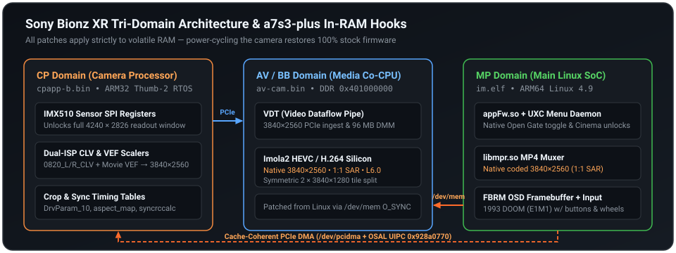

# a7s3-plus

**Full-Sensor 3:2 Open Gate Video, Cinema Menu Unlocks & Classic 1993 DOOM for Sony A7S III (`ILCE-7SM3`, Firmware `5.01`)**



> [!WARNING]
> **Experimental Research Software — Read Before Running**
> - Targets **Sony A7S III (`ILCE-7SM3`) running firmware `5.01` ONLY**. Every patch verifies expected stock instruction/table bytes before modifying RAM; do not run on other models or firmware versions.
> - **100% Volatile RAM Mode by Default (`./install_clean_camera.sh`):** Turning the camera power switch **OFF** wipes all patches from RAM and returns to stock Sony firmware.
> - **Optional Fail-Safe Persistence v2 (`./install_clean_camera.sh --persist`):** Auto-loads Open Gate 3:2, Cinema unlocks, BIG6, Variable Shutter, and DOOM after power-off & battery pull while keeping Sony's `0.5s` WBI2 fast boot — protected by an **Auto-Disarm dead-man's switch** (`boot_tries >= 2`) and a **physical SD-card kill-switch** (create an empty `NO_MOD` file on any SD card to revert to 100% stock without USB).
> - **Not everything is polished yet:** see [What Works & Known Rough Edges](#what-works--known-rough-edges) below. Use at your own risk.

---

## What `a7s3-plus` Unlocks

1. **True Native `3840 × 2560` (`1:1` SAR, `3:2` DAR) Open Gate Video (`4240 × 2826` readout — `+18.5%` vertical height)**
   - Reconfigures the IMX510 sensor SPI readout window, dual-stripe ISP scalers (`0820_L_CLV` / `0820_R_CLV`), and the surgical Movie YC / VEF scaler on the real-time front-end processor (`CP`) to deliver all **2,826 vertical lines** cleanly at **`3840 × 2560`** without touching HDMI VSYNC timing.
   - Reconfigures Sony's `VDT` PCIe pipeline and `Imola2` dual-core hardware encoder (via a 96 MB `DMM 0x486 ↔ 0x474` `FrmBuf LD` swap and symmetric `2 × 3840×1280` tile split) to encode **true square-pixel `3840 × 2560` (`1:1` SAR, `3:2` DAR)** 10-bit 4:2:2 / 4:2:0 `XAVC HS 4K` (HEVC Level 6.0) and `XAVC S 4K` (H.264) directly to SD/CFexpress with full 48 kHz PCM audio and Sony `rtmd` gyro metadata.
   - **Always-On In-Camera Playback (`3840 × 2560` + `3840 × 2160`):** routes `3840 × 2560` `IMLDEC` decode frames through Sony's native **EBC 1.25 Bpp (`5/4`)** compressed decode pool (`DMM 0x369`), allowing seamless in-camera playback of both Open Gate `3840 × 2560` and standard `3840 × 2160` clips regardless of whether Open Gate is toggled On or Off.
   - **Full-Screen Unsquished `3:2` Display (Live View, Recording, Playback & Focus Magnifier):** hooks `appFw.so`'s CP VDF layout IPC (`CMD=0x0147` manual-rect mode `ent[1]=0` and `CMD=0x014c` Focus Magnifier) plus layout rows 2 & 7 (`0x4b72818`) to render true unsquished `3:2` geometry on the rear LCD/EVF (`0, 26, 640, 428`) and pillarboxed `3:2` on 16:9 HDMI (`50, 0, 540, 480`) — including live 1.0×/4.0× Focus Magnifier with joystick panning — while keeping Still Photo mode 100% stock.
   - **Full-Sensor Defect Pixel Correction (`ZIT`/`DDX`, Zero Hot Pixels):** redirects CP's in-RAM `0x0820` defect dictionaries (`0x01260fc8` factory + `0x012630b8` user Pixel Mapping) to the uncropped `4264 × 2848` full-sensor bucket (`B[0]`) so all 2,826 rows receive exact hardware hot-pixel suppression (and restores stock `16:9` buckets cleanly when Open Gate is toggled Off).
   - Zero black bars, zero anamorphic squeeze, zero post-production desqueeze required — native `3840 × 2560` frames open directly in DaVinci Resolve, Premiere Pro, Final Cut Pro, and QuickTime Player.
2. **Native Camera Menu Integration (`Open Gate 3:2 3840x2560`)**
   - Injects a live **On / Off** toggle with English help tooltips right inside Sony's native menu UI, cleanly switching all three Bionz XR processors (`MP`, `AV/Imola/VDT`, `CP`) between **Native `3840 × 2560` 3:2 Open Gate** and **Stock `3840 × 2160` 16:9 4K** directly on the camera without a computer.
   - Preserves Sony's native **Anamorphic De-Squeeze Display** menu option intact.
3. **Cinema & Body Firmware Unlocks**
   - **Hardware Shutter Angle (`Shutter Mode: Speed / Angle`):** unlocks `Shutter Mode` and all 29 FX3 shutter angles (`64F..2F`, `360.0°..5.6°`), restores the stripped `ShutterMode == 1` CP `PID 0x401c` encoder (`hook_355bda0`), hooks the physical shutter dial (`hook_26a6f4c`), and automatically recalculates real sensor exposure when switching recording frame rates (`24p / 25p / 30p / 50p / 60p / S&Q`).
   - **Cine EI / Cine EI Quick / Flexible ISO + Base ISO `800 / 12800` + Exposure Index:** unlocks the full FX3 Log Shooting stack with correct `0 = enabled` capability polarity, exact `±2 EV` sensor EI ranges (`200–3200 EI` @ Base 800, `3200–51200 EI` @ Base 12800, `200–51200 EI` in Cine EI Quick), physical ISO-wheel EI stepping hooks (`0x26cb554..0x26c9c84`), and `Embed LUT File` alongside User LUTs / `Display LUT`.
   - **Full 16-Ratio Aspect Markers:** unlocks the 7 hidden Cinema Line frame markers (`9:16`, `4:5`, `1:1`, `17:9`, `1.91:1`, `2:1`, `2.39:1`) cleanly inside the single stock `Aspect Marker` menu item (`0x1a4`, no duplicate entry).
   - **Variable Shutter (Fine Anti-Flicker Decimal Shutter) in Movie Mode:** unlocks `Var. Shutter` / `Var. Shutter Set.` menu items, `Custom Key Setting` bindings (`Var. Shutter Select` / `Var. Shutter Set.`), live decimal `60.0` readout (suppressing the duplicate RTOS OSD), and fine rear-wheel stepping during video shooting.
   - **FX3 BIG6 Cinema Home Screen:** unlocks `"Home"` in `Custom Key Setting` (NVRAM `0x0b70`) and includes `big6_key_hook.so` (`0x114 -> 0x187`) so pressing the assigned Custom Key (or swiping down) opens BIG6 immediately.
   - **Anti-Dust Shutter When Power OFF & 24.00p Modal Bypass:** unlocks hidden body features and suppresses confirmation popups when switching DCI/UHD frame rates.
4. **Bonus Easter Egg: Playable 1993 DOOM (`E1M1`) on Bionz XR**
   - Hidden inside **`MENU → Setup → Display Option → 1993 DOOM (E1M1)`**.
   - Renders directly into Sony's `FBRM` hardware OSD framebuffer with physical camera buttons/wheels mapped to movement, strafing, weapon switching, and fire.



---

## Deep-Dive Documentation

Want to know how everything works at the register, DMA, and instruction level?

- **[`docs/HOW_IT_WORKS.md`](docs/HOW_IT_WORKS.md)** — Full reverse-engineering walkthrough of Sony's Bionz XR tri-processor architecture (`MP` Linux + `AV/BB` Imola RTOS + `CP` ISP/sensor RTOS), PCIe DMA patching, VUI/MP4 container math, UXC menu resource hooking, and the DOOM framebuffer port.
- **[`docs/BIONZ_XR_FIRMWARE_AND_CINEMA_UNLOCKS.md`](docs/BIONZ_XR_FIRMWARE_AND_CINEMA_UNLOCKS.md)** — Cross-body Bionz XR firmware comparison (`A7S III` vs `FX3` vs `A7 IV` vs `ZV-E1`), BIG6 Cinema Home Screen & persistent Custom Key NVRAM IDs, dual-renderer Variable Shutter architecture, and the 116-entry [`analysis/bkid_catalog.csv`](analysis/bkid_catalog.csv) Backup property catalog.
- **[`docs/SAFETY_AND_POSTMORTEM.md`](docs/SAFETY_AND_POSTMORTEM.md)** — Complete NAND partition map (`nflasha*`), post-mortem of an early USB bootloop during persistent-boot testing, the `SET_FILE2` relative-path trap, and how `check_coldboot.py` verifies camera health.
- **[`docs/NATIVE_3840x2560_RESEARCH.md`](docs/NATIVE_3840x2560_RESEARCH.md)** — Complete reverse-engineering write-up of how **native `1:1` square-pixel `3840 × 2560`** hardware encoding was unlocked (`Imola2` `createEncPool` 96 MB DMM pool swap, symmetric `2 × 3840×1280` tile split, `VDT`, and surgical `CP VEF` scaler).

---

## Quick Start (macOS / Linux)

### 1. Prerequisites
- **Camera:** Sony A7S III (`ILCE-7SM3`) on **Firmware `5.01`**, battery > 50%.
- **Camera USB settings:**
  - `MENU → Setup → USB → USB Connection Mode` → **Mass Storage** *(or Sel. When Connect → Mass Storage)*
  - `MENU → Setup → USB → USB LUN Setting` → **Multi**
- **Host computer:** Python 3.9+ and `libusb`:
  ```bash
  # macOS (Homebrew)
  brew install libusb
  ```
  `./install_clean_camera.sh` automatically creates a local `.venv` and installs `requirements.txt` (`pyusb` on macOS/Linux — no `axmlparserpy` or extra PlayMemories packages required). If you run `analysis/*.py` manually without the shell launcher, install dependencies once via `pip install -r requirements.txt`.

### 2. Optional: Add `DOOM1.WAD` (for the in-menu DOOM Easter egg)
For copyright reasons, **no WAD game data is included in this repository**.
- **If you skip this step:** `./install_clean_camera.sh` automatically loads **Open Gate 3:2 + Native Menu Toggle + Cinema Unlocks** without DOOM.
- **To enable `1993 DOOM (E1M1)` in the camera menu:** place a valid IWAD file in the repository root (next to `install_clean_camera.sh`) named `DOOM1.WAD`, `doom1.wad`, or `freedoom1.wad`:
  - **Option A (Original 1993 Shareware Episode 1):** Download id Software's freely redistributable shareware `doom1.wad` (`v1.9`, `4,196,020` bytes, SHA-1 `5b2e249b9c5133ec987b3ea77596381dc0d6bc1d`) from the [Doomworld idgames archive (`doom19s.zip`)](https://www.doomworld.com/idgames/idstuff/doom/doom19s) or copy `DOOM.WAD` from your Steam / GOG installation.
  - **Option B (100% Open-Source BSD Replacement):** Download `freedoom1.wad` from [Freedoom Releases](https://github.com/freedoom/freedoom/releases) and place it in the repository root.

The loader automatically compresses your WAD file to `runtime/doom1.wad.gz` on first run.

### 3. Load into Camera RAM
Connect the powered-on camera in Movie mode via USB-C and run:

```bash
git clone https://github.com/ilovemycamera/a7s3-plus.git
cd a7s3-plus

# Default: loads Open Gate 3:2 + Native Menu + Cinema Unlocks (+ DOOM if WAD is present)
./install_clean_camera.sh
```

Useful commands:
```bash
# Load Open Gate 3:2 + Cinema Unlocks ONLY in RAM (skip DOOM upload even if WAD exists)
./install_clean_camera.sh og_menu

# Enable fail-safe Persistence v2 (survives Power OFF, WBI2 fast boot & battery pulls)
# Built-in safety: Auto-Disarm after 2 failed boots + SD-card NO_MOD kill-switch
./install_clean_camera.sh --persist

# Disable Persistence v2 (returns to 100% stock Sony boot)
./install_clean_camera.sh --disarm

# Read-only boot, Persistence v2 & partition health check (modifies nothing)
./install_clean_camera.sh --check
./install_clean_camera.sh --persist-status

# Emergency boot-config reset if you ever experiment with custom scripts
./install_clean_camera.sh --recover
```

After `./install_clean_camera.sh` finishes (`=== ALL DONE ===`), unplug USB and shoot!

### Optional: Desktop GUI Launcher (macOS / Linux)
Prefer buttons over terminal commands? Double-click **`A7S3-Control.command`** on macOS or run:
```bash
python3 A7S3-Control.py
```
The built-in `tkinter` control panel lets you check USB/boot status, load `og_menu` or `doom`, toggle CP 3:2 patches, restore clean stock state, and run the Open Gate MP4 inspector/fixer without extra dependencies.

---

## Post-Production: Open Gate 3:2 MP4 Inspector & Lossless Fixer

Included in [`tools/opengate_mp4_tool.py`](tools/opengate_mp4_tool.py) (zero dependencies, pure Python 3 stdlib, supports `>4 GB` Sony XAVC S / HS files):

```bash
# Inspect coded resolution, tkhd display ratio, pasp, and Sony RTMD gyro survival
python3 tools/opengate_mp4_tool.py inspect C0001.MP4

# Losslessly patch MP4 tkhd display height to 3840x2560 (0s re-encode, keeps Sony RTMD gyro intact)
python3 tools/opengate_mp4_tool.py tag-3x2 C0001.MP4 -o C0001_3x2.MP4

# Generate ready-to-run 10-bit ProRes 422 HQ / VideoToolbox HEVC square-pixel 3840x2560 FFmpeg commands
python3 tools/opengate_mp4_tool.py ffmpeg-cmd C0001.MP4
```

---

## Developer & Research Bench

For Bionz XR researchers building on top of `a7s3-plus`:

```bash
# Read-only camera telemetry (kernel, im.elf PID, appFw.so base, active maps)
sudo -E .venv/bin/python analysis/stand.py status

# Execute a read-only shell command inside im.elf over USB MSC
sudo -E .venv/bin/python analysis/run_jit_command.py "uname -a; cat /proc/snsc_boot_time"

# Read an arbitrary file from camera RAM/rootfs to stdout
sudo -E .venv/bin/python analysis/read_camera_file.py /tmp/jiritsu/og-menu-daemon.txt
```

Static Backup NVRAM property definitions (`116` verified `BKID_APP_*` records) are indexed in [`analysis/bkid_catalog.csv`](analysis/bkid_catalog.csv).

---

## What Works & Known Rough Edges

| Feature | Status | Notes |
|---|---|---|
| **True Native `3840 × 2560` (`1:1` SAR) Open Gate 3:2** | **Working (Default)** | Full `4240 × 2826` sensor height encoded natively at **`3840 × 2560`** square pixels (`XAVC HS 4K` HEVC 10-bit 4:2:2/4:2:0 Level 6.0 & `XAVC S 4K` H.264 25p/50p, `1:1` SAR, `3:2` DAR, zero black bars, full `rtmd` gyro). |
| **Always-On In-Camera Playback (`3840 × 2560` & `3840 × 2160`)** | **Working** | Permanent 23-word `IMLDEC` EBC `1.25 Bpp` (`5/4`) decode patch plays both Open Gate `3840 × 2560` and standard `3840 × 2160` clips directly on camera. |
| **Full-Screen Unsquished `3:2` Display & Focus Magnifier (LCD, EVF & HDMI)** | **Working** | CP VDF `CMD=0x0147` manual-rect override + Row 2 / Row 7 layout patching displays accurate unsquished `3:2` proportions in Live View, Recording, Playback, and live 1.0×/4.0× Focus Magnifier (`0,26,640,428` on LCD/EVF; `50,0,540,480` on HDMI, preserving `PIN Aspect == Dev Aspect` in CP VDF `0x001e9204`); Still Photo remains stock. |
| **Full-Sensor Hot-Pixel Suppression (`CP ZIT/DDX`)** | **Working** | Redirects CP's `0x0820` factory (`0x01260fc8`) and dynamic Pixel Mapping (`0x012630b8`) defect-correction keys to full-sensor uncropped `B[0]` (`4264 × 2848`) so Open Gate video has zero hot pixels across all 2,826 rows; restores stock `16:9` buckets when toggled Off. |
| **Native Menu Toggle (`Open Gate 3:2 3840x2560`)** | **Working** | Live On/Off switch on camera cleanly toggling `MP`, `AV/Imola/VDT`, `CP_RAM`, `CP_VEF`, and `CP_DDX` between native `3840 × 2560` 3:2 and stock `3840 × 2160` 16:9. |
| **Hardware Shutter Angle (`Speed / Angle`)** | **Working** | Restores FX3's `PID 0x401c` CP angle encoder (`hook_355bda0`), physical wheel stepping (`hook_26a6f4c`), and automatic exposure recalculation across Rec FPS / S&Q changes (hardware-verified: e.g. `90.0° @ 50p -> 1/200s` vs `@ 25p -> 1/100s`); persists across cold reboots. |
| **Cine EI / Cine EI Quick / Base ISO `800 & 12800` / Embed LUT** | **Working (Needs More Field Testing)** | Full Log Shooting stack unlocked with native `VDF CMD 0x0134` (`vdf_set_ei_gain`), exact FX3 `±2 EV` EI ranges, 6 ISO-wheel EI stepper hooks, and `Embed LUT File`; live RAM hooks verified across cold reboot. |
| **16-Ratio Aspect Markers (`9:16`, `4:5`, `2.39:1`, …)** | **Working** | All 16 ratios unlocked on stock `Aspect Marker` leaf `0x1a4` with duplicate leaf `0x1a5` kept hidden. |
| **Movie Variable Shutter, BIG6 Home Screen & Power-Off Shutter Unlock** | **Working** | Menu items, Custom Key Setting (`Var. Shutter Select/Set.`, `Home/BIG6`), `C1` → BIG6 key hook, decimal `60.0` readout & rear-wheel stepping. |
| **1993 DOOM (`MENU → Setup → Display Option`)** | **Working** | Playable on LCD/EVF with physical controls. |
| **Persistence Across Power Off & Battery Pull (`--persist`)** | **Working (Optional)** | Cold-boot verified (`INIT_V26_CINEMA_LINE`) using an atomic single-FIFO reconfigure (`sequence_set_movie_format` + `sequence_restart_ee` + `sequence_change_hdmi_resolution`) followed by a synchronized post-EE `3:2` viewport refresh — opens directly into clean unsquished `3:2` Live View with zero cold-boot or Playback → Movie glitches. Preserves `0.5s` WBI2 fast boot; protected by Auto-Disarm (`boot_tries >= 2`), SD-card `NO_MOD` kill-switch, and clean USB coexistence. Default mode remains 100% volatile RAM. |
| **High Frame Rates (`100p / 120p`) & S&Q** | **Partial / Untested** | Sensor timing tables (`DrvParam_10`) are tuned for full-sensor readout (`24p / 25p / 30p / 50p / 60p`); switching to `100p/120p` or S&Q may fall back to 16:9 or require toggling Open Gate Off first. |

---

## Rebuilding Camera Modules from Source (Optional)

Prebuilt AArch64 `.so` payloads (`~430 KB` total) are included in `runtime/` for convenience. To rebuild every module from C/C++ source using `clang` + `ld.lld`:

```bash
# macOS
brew install llvm lld

# Build all Open Gate & Cinema Menu .so modules
make -B core

# Rebuild the freestanding AArch64 DOOM engine module (runtime/doom_a7s3.so.gz)
make doom
```

---

## Credits & Acknowledgments

- **Research, Reverse Engineering & Patches:** [@ilovemycamera](https://github.com/ilovemycamera)
- **USB / Senser Protocol Library:** [`ma1co/sony-pmca-re`](https://github.com/ma1co/sony-pmca-re) (MIT License)
- **DOOM Engine Base:** [`ozkl/doomgeneric`](https://github.com/ozkl/doomgeneric) & id Software's GPL-2.0 Linux DOOM release
