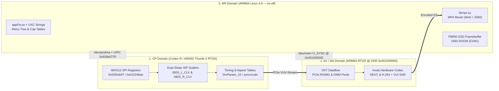

# How `a7s3-plus` Works Under the Hood

Sony's **A7S III (`ILCE-7SM3`)** is built around the **IMX510** full-frame back-illuminated CMOS sensor (`4240 × 2826` active pixels, `3:2` aspect ratio, `35.6 × 23.8 mm`) and the **Bionz XR** multi-SoC architecture.

Although the camera happily captures full `4240 × 2826` `3:2` RAW/HEIF/JPEG stills, switching to Movie mode instructs the front-end silicon to crop **442 horizontal lines** (`221` top + `221` bottom), throwing away **18.5% of the sensor's vertical area** before the video encoder ever sees a frame.

Unlocking true `3:2` Open Gate video required tracing and patching **three separate processors running two different operating systems and two different ARM instruction sets** — all from volatile RAM without modifying flash.

---

## 1. The Three Worlds Inside Sony Bionz XR

| Domain | Firmware Binary | ISA / OS | Role in Video Pipeline |
|---|---|---|---|
| **`MP`** (`ipsxmp`) | `/usr/bin/im.elf`, `/usr/lib/appFw.so`, `/usr/lib/libmpr.so` | `AArch64` Linux 4.9 | Main application UI, menu state machine, SD/CFexpress filesystem, MP4 container muxer (`libmpr.so`), OpenGL ES / `FBRM` OSD overlay. |
| **`AV / BB`** | `av-cam.bin` (loaded at physical DDR `0x401000000`) | `AArch64` RTOS | Video Dataflow (`VDT`) router and **`Imola`** hardware HEVC / H.264 encoder & bitstream SPS/VUI generator. |
| **`CP`** (`ipsxcp`) | `cpapp-b.bin` (loaded at `0x00108000` in CP RAM) | `ARMv7` Thumb-2 RTOS | Real-time camera front-end: IMX510 sensor SPI programming, dual-ISP left/right stripe scalers (`CLV`), autofocus, IBIS, exposure timing. |

Why previous attempts at Sony "menu hacks" could never unlock Open Gate: **`appFw.so` on Linux does not control sensor crop geometry**. Even if you force a `3:2` flag on Linux, `CP` still programs the IMX510 SPI registers for `2,384` lines and clamps the dual-ISP scaler to `16:9`.

---

## 2. Entry Point: Volatile RAM Code Execution via `Senser` & `libJit.so`

When connected over USB in Mass Storage mode, Sony's diagnostic subsystem (`senser`) accepts vendor SCSI/USB commands (`sony-pmca-re`). Switching into service shell mode exposes two primitives inside `/tmp/jiritsu`:
1. Root shell script execution for preflight inspection (`check_coldboot.py`).
2. **`LIBJIT` dynamic library loading inside `im.elf`**: writing a freestanding AArch64 shared object (`.so`) with `-Wl,-init,_init` triggers `dlopen()` inside the running `im.elf` process.

Every `a7s3-plus` module (`cp_opengate_patch.so`, `menu_repair.so`, `high_res_display_v10.so`, `og_menu_daemon_v15.so`) is written in **freestanding C/C++ (`-nostdlib`) using direct Linux AArch64 `svc #0` syscalls** (`openat=56`, `read=63`, `write=64`, `mmap=222`, `mprotect=226`, `ioctl=29`, `mount=40`), avoiding any `glibc` symbol-version dependencies.

---

## 3. Patching `CP` Across the PCIe Bus (`cp_opengate_patch.cpp`)

`CP`'s RAM (`0x00108000 .. 0x02000000`) is **not** directly memory-mapped into Linux's physical address space — `CP` sits across a PCIe link (`/usr/kmod/pciedma.ko` + `pci_ep_cp.ko`). Worse, `CP` has its own data/instruction caches: a blind PCIe DMA write would either be overwritten by dirty `CP` cache lines or ignored by `CP` reads!

By reverse-engineering Sony's internal diagnostic helpers in `libosal_uipc.so`, we reconstructed the exact **cache-coherent cross-SoC DMA protocol**:

1. **Allocate a physical `DMM` bounce buffer on `MP`** by sending message `0x20` (`unit_type = 0x192`) to the `DMM` kernel server (`0x0061003c`).
2. **Invalidate/Clean `CP` caches remotely** before and after DMA by sending a synchronous `OSAL UIPC` message (`0x150` bytes) to `CP` cache-control endpoint **`0x928a0770`** (`msg+0x18 = cp_addr`, `msg+0x20 = size`, `msg+0x26 = dir`).
3. **Execute 64-byte-aligned PCIe DMA transfers** via `ioctl(fd, 0x40185001, &req)` on `/dev/pcidma` (`dir = 0` for `CP -> MP` readback verification, `dir = 1` for `MP -> CP` write).

### What We Patch in `CP` (`25` Verified Regions in `cp_og_patches.h`)
Before writing a single byte, `cp_opengate_patch.cpp` reads all 25 regions over PCIe DMA and verifies that every byte matches either `stock` (`5.01`) or `og`:

- **IMX510 Sensor SPI Register Tables (`spi_row*` @ `0x00f2eb97..0x00f2ee27` & `spi_data_reg*` @ `0x01019bee..0x01019cca`):** Expands the vertical readout window of movie mode `0820` from cropped `16:9` (`2,384` lines) to the full `3:2` active array (`2,826` lines).
- **Dual-ISP Left & Right Stripe Scalers (`0820_L_CLV` @ `0x00bcfff8` & `0820_R_CLV` @ `0x00bd0bb0`, `3,000` bytes each):** Bionz XR splits high-speed sensor readout vertically into Left and Right halves processed by twin ISP pipelines. Both `CLV` descriptor blocks are updated from `0x0968`/`0x0974` (`~2,408` input height) to `0x0b20`/`0x0b3c` (`~2,848` full-height input), scaling the entire `4240 × 2826` image cleanly into the `3840 × 2160` output frame.
- **Sensor Drive & Sync Timing (`DrvParam_10` @ `0x01fe129c`, `t14_10..t38_10`, `syncrccalc` @ `0x00426f6c`):** Updates line-count, blanking, and rolling-shutter sync calculators so `CP`'s real-time VSYNC state machine accepts the taller `2,826`-line readout without faulting.
- **Aspect & Crop Clamping (`size_class_0820` @ `0x00c754ac`, `crop_table_0820` @ `0x00c1800e`, `aspect_map` @ `0x004226e8`, `aspect_override` @ `0x014a59a2`):** Prevents `CP` post-ISP stages from re-cropping the `3:2` frame back to `16:9`.

---

## 4. Zero-Click `3840 × 2560` NLE Desqueeze (`Imola` VUI + `libmpr.so` `tkhd`)

Once `CP` feeds the full `4240 × 2826` (`3:2`) sensor image into the `3840 × 2160` (`16:9`) hardware encode buffer, every pixel carries an optical sample aspect ratio of:

$$\text{SAR} = \frac{3 / 2}{16 / 9} = \frac{27}{32} = 0.84375 \quad \Longrightarrow \quad 2160 \times \frac{32}{27} = 2560$$

To make every NLE and media player unfold the image to **`3840 × 2560` (`3:2`) automatically** (preserving full `3840` horizontal pixels and expanding vertical display height to `2560`):

1. **`AV / Imola` Hardware Bitstream VUI Patch (`av-cam.bin` @ physical DDR `0x401000000`):**
   `AV`'s firmware lives in physical DDR starting at `0x401000000`. Mapping `/dev/mem` with `O_RDWR | O_SYNC` (`0x101002`), we patch 6 instructions in `create_imola_enc_start_param`:
   - **HEVC (`XAVC HS 4K` @ `0x40121c008..0x40121c018`):** Sets `aspect_ratio_idc = 255` (`Extended_SAR`), `sar_width = 27`, `sar_height = 32`.
   - **H.264 (`XAVC S 4K` / `XAVC S-I 4K` @ `0x40121c388..0x40121c398`):** Sets `aspect_ratio_idc = 255`, `sar_width = 27`, `sar_height = 32`.
2. **`MP` MP4 Track Header Patch (`libmpr.so` @ `+0x2272b0` & `+0x229a24`):**
   Replaces `lsl w23, w23, #16` (`2160.0` in 16.16 fixed-point) with `movz w23, #0x0a00, lsl #16` (`2560.0`), writing `3840 × 2560` directly into the MP4 `tkhd` atom!

---

## 5. Native Sony Menu Toggle & Cinema Unlocks (`menu_repair.cpp` + `og_menu_daemon.cpp`)

Instead of forcing you to tether a laptop every time you want to switch between `3:2` Open Gate and standard `16:9` 4K:

1. **Live UXC String Resource Patching:**
   Sony stores localized UI strings inside `/usr/share/app/string_english_f.uxc` on the read-only `/usr` (`nflasha15`) partition — and caches a copy in `im.elf` heap memory.
   - `menu_repair.cpp` copies `string_english_f.uxc` to RAM, patches unused/repurposed string slots (`"Open Gate 3:2 Recording"`, `"1993 DOOM (E1M1)"`, plus full multi-line help descriptions), and bind-mounts (`MS_BIND`) it over `/usr/share/app/string_english_f.uxc`.
   - `og_menu_daemon.cpp` also scans `im.elf` anonymous RW mappings and updates any already-cached UXC table in RAM on the fly.
2. **`appFw.so` Menu Callback Hook (`+0x5875d40`):**
   `og_menu_daemon_v15.so` hooks the leaf callback of the repurposed menu item in `appFw.so` (`base + 0x5875cb8 + 0x88`). Flipping **On / Off** in the Sony menu triggers a background worker thread inside `im.elf` that atomically applies or restores all 25 `CP` DMA patches, the 6 `AV` VUI patches, and the 2 `libmpr.so` `tkhd` patches in under 150 ms!
3. **Cinema & Body Unlocks (`high_res_display_v10.cpp` & `menu_repair.cpp`):**
   - Unlocks **Variable Shutter** wheel stepping in Movie mode (`appFw.so + 0x1b6e1e8` -> `NOP`, decimal display formatting at `+0x1878a04`).
   - Unlocks **Shutter / Anti-Dust Curtain When Power OFF** capability tables (`+0x551b760`, `+0x5567e50`).
   - Bypasses modal confirmation aborts on PAL / `24.00p` DCI/UHD format switches (`+0x269228c`, `+0x26082dc`).

---

## 6. Running Classic 1993 DOOM on a Full-Frame Cinema Camera (`doomgeneric_a7s3.cpp`)

Because `im.elf` owns both the camera's physical button/dial input stream and the OSD graphics plane, porting DOOM as an in-process shared library (`doom_a7s3.so`) turned out to be remarkably clean:

- **Display (`FBRM` Hardware OSD Singleton):** `im.elf` renders its UI through an internal framebuffer manager (`FBRM`). `doomgeneric_a7s3.cpp` locates the live `FBRM` singleton in `libobj`, locks the RGBA8888 OSD surface, blits and integer-scales the 320×200 paletted DOOM frame into the camera's LCD/EVF resolution, and swaps buffers cleanly at 35 fps while suppressing normal OSD redraws.
- **Physical Controls:** Hooks the `im.elf` key/dial dispatch callback, translating the multi-selector D-pad, center button, `AF-ON`, `AEL`, shutter/REC, and control wheels into movement, turning, strafing, weapon cycling, `Use`, and `Fire` — with `MENU` cleanly suspending DOOM and returning you to normal shooting!
- **Freestanding Toolchain (`runtime/linux_inc`):** Compiled with `--target=aarch64-linux-gnu -mno-outline-atomics` and custom wrappers (`a7s3_doom_exit`, `a7s3_printf`) so quitting DOOM never calls `exit()` on `im.elf`!
